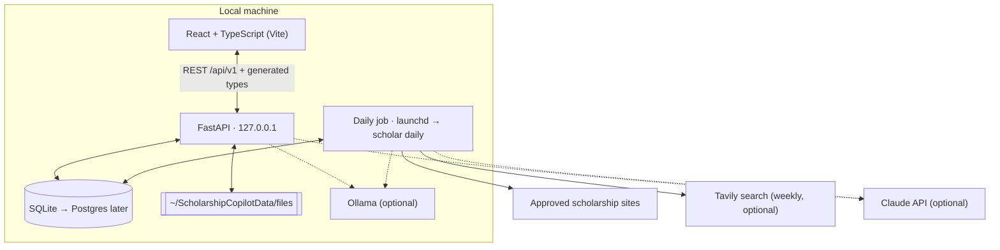

# Architecture — Scholarship Copilot

Condensed from the approved proposal (https://claude.ai/artifact/9MgugoaywTNCqbKR62DzAE).
Update this file whenever an architectural decision changes, and record the change in the decision log below.

## System overview



## Stack

| Layer | Choice |
|---|---|
| Backend | Python 3.13 (uv), FastAPI, Pydantic, SQLAlchemy 2, Alembic |
| Database | SQLite (local) → PostgreSQL (cloud) |
| Frontend | React, TypeScript, Vite, Tailwind CSS, shadcn/ui, TanStack Query, React Router, react-hook-form + zod |
| API contract | FastAPI OpenAPI schema → `openapi-typescript` generated types |
| Scraping | httpx, trafilatura, Playwright (JS-only pages), urllib.robotparser |
| Parsing | pypdf / pdfplumber, python-docx; python-multipart for uploads |
| Matching | rapidfuzz |
| AI | Provider interface: `none` · `ollama` · `anthropic` |
| Tests | pytest, Vitest + Testing Library, Playwright e2e |
| Quality | ruff, mypy, pylint, oxlint, Prettier, pre-commit, gitleaks, GitHub Actions |

## Repository layout (planned)

```
scholarship-copilot/
  api/                     Python backend (uv project)
    app/
      api/                 HTTP routes only
      modules/             profile, sources, discovery, eligibility, ranking, packets, coaching, notify
      ai/                  provider switch, prompts, output schemas
      jobs/                CLI jobs (daily, recheck, digest, background on/off)
      core/                config, db session, logging, security helpers
    migrations/            Alembic
    tests/
  web/                     React frontend (Vite)
    src/{api,components,features,routes}
  extension/               Chrome extension (Phase 9)
  ops/launchd/             launchd agent template
  docs/                    extra docs and screenshots
```

## Key design rules

1. **Eligibility verdicts are deterministic code.** AI extracts criteria (with quotes), and code evaluates them.
2. **Layering:** routes → services → repositories. Routes contain no business logic.
3. **Jobs are CLI commands.** Any scheduler (launchd, cron, cloud) can run them. Each run writes a `job_runs` row.
4. **Background on/off:** `scholar background off` unloads the launchd agent (`launchctl bootout`), and `on` loads it again. The app's Settings page calls the same code. Ollama's idle unload keeps model memory free when not in use.
5. **Status changes enforced by the system**, with an audit log for approvals and submissions.
6. **Untrusted input:** scraped text is passed to AI as data, never as instructions. The fetcher blocks private IP ranges.
7. **Data outside the repo:** `~/ScholarshipCopilotData/` (DB, files, backups). Path set via env var.

## Core data model (initial)

`users`, `profiles`, `profile_facts`, `stories`, `sources`, `source_candidates`, `page_snapshots`,
`scholarships`, `scholarship_cycles`, `criteria`, `eligibility_results`, `packets`, `packet_items`,
`responses`, `response_versions`, `documents`, `notifications`, `settings`, `job_runs`, `audit_log`.

## Decision log

| Date | Decision | Reason |
|---|---|---|
| 2026-11-26 | Python backend + React/TS frontend | Python strengths for scraping/AI. React/TS is the industry standard (user preference). |
| 2026-11-26 | SQLite first | Single local user; no server to run. ORM keeps Postgres migration cheap. |
| 2026-11-26 | Hybrid mode as flagship; no auto-submit | Legal, ToS, and integrity limits. Highest value per effort. |
| 2026-11-26 | Code decides eligibility | Auditable, testable, never presents a guess as a confirmed match. |
| 2026-11-26 | launchd daily job with on/off switch | Runs on wake after sleep. User can free resources on demand. |
| 2026-11-26 | TypeScript pinned to 5.9 (not 7) | `openapi-typescript` needs TS 5.x. Revisit when it supports TS 7. |
| 2026-11-26 | oxlint instead of ESLint | Ships with the Vite template, very fast, covers React hooks + TS rules. Fewer plugins than ESLint; revisit if a needed rule is missing. |
| 2026-11-26 | Test HTTP client: `httpx2` | Starlette's TestClient deprecated `httpx`. Same maintainer (pydantic/httpx2). |
| 2026-11-26 | Profile facts come from a typed catalog defined in code | Eligibility (Phase 5) compares typed values deterministically; "never ask twice" (FR-P4) is a lookup by key. Scholarship-specific answers are stored as custom text facts. |
| 2026-11-26 | Forms: react-hook-form + zod | Owner-approved. Schema-based validation and types for ~6 forms, instead of hand-rolled state. |
| 2026-11-26 | Phase 4 resume import is rule-based | Owner-approved. AI extraction joins the same confirm-each-fact flow in Phase 5. Works with AI provider = none (NFR-6). |
| 2026-11-26 | python-multipart added for uploads | Owner-approved. FastAPI's documented dependency for file uploads (resume import). |
| 2026-11-26 | Native `<select>` (shadcn native-select) instead of Radix Select | Accessible by default (keyboard, screen readers, mobile pickers) and testable in jsdom. Enough for every choice field so far. |
| 2026-11-26 | Resume provenance is decided by the server | Confirm re-runs the deterministic extraction on the stored file: unchanged = `resume`, edited = `manual`. The browser can't label a value "from your resume" that isn't in it. |
| 2026-11-26 | Uploaded files: random names, 0600, behind `FileStorage` | Hostile file names can't choose paths; files stay in the data dir (NFR-1); swappable for cloud storage (NFR-8). |
